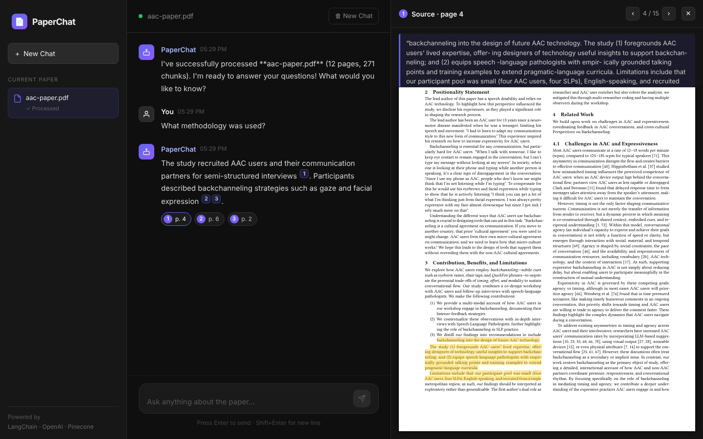

# 📄 PaperChat

> Chat with your research papers using AI. Upload any PDF and ask questions in natural language — an agentic RAG app on AWS: Python on Lambda, Amazon Bedrock (OpenAI GPT-5.6 + Titan embeddings), LangChain, Pinecone, S3 and CloudFront.

[](https://paperchat-bixg7nbyg-merub-shaikhs-projects.vercel.app/)
[](https://typescriptlang.org)
[](https://nextjs.org)
[](https://openai.com)
[](https://pinecone.io)

---

## 📌 Overview

PaperChat is a full-stack RAG (Retrieval-Augmented Generation) application that allows users to upload research papers and ask questions about them in natural language. Instead of reading through pages of dense academic text, users can get instant, accurate answers grounded in the paper's content.

Built as part of a research project at **Illinois Institute of Technology**, where qualitative research on assistive technology and mobility aids informed the design of accessible, user-centered interfaces.

---

## Features

- **📤 Drag & Drop Upload** — Upload any PDF research paper instantly
- **🧠 Semantic Search** — Finds relevant sections by meaning, not just keywords
- **💬 Conversational Q&A** — Ask questions in natural language
- **⚡ Fast Retrieval** — Sub-second responses using Pinecone vector database
- **🎯 Context-Aware** — GPT-5.6 answers grounded in your specific document
- **🔗 Clickable Citations** — Every answer cites its sources as `[1]` markers and page chips; click one to open the PDF at that page with the exact passage highlighted
- **🌙 Dark Mode UI** — Modern ChatGPT-like interface
- **📱 Responsive Design** — Works on desktop and mobile
- **🔒 Secure** — Files processed in memory, not stored permanently

---

## Screenshots

### Upload Screen


### Chat Interface


### Clickable Citations



---

## How It Works

```
📄 PDF upload            Browser → S3 (presigned POST; size and type enforced by S3)
     ↓
📝 Text extraction       pypdf, one text per page (Lambda reads the PDF from S3, then deletes it)
     ↓
✂️  Chunking             LangChain RecursiveCharacterTextSplitter (500 chars, 150 overlap)
     ↓
🔢 Embeddings            Amazon Titan Text Embeddings V2 on Bedrock (1024 dims, parallel calls)
     ↓
🗄️  Vector storage       Pinecone, one namespace per paper
     ↓
❓ Question
     ↓
🔍 Retrieval             Embed question + Pinecone top-6 (sub-second; latency logged to CloudWatch)
     ↓
🤖 Agent                 GPT-5.6 Sol on Bedrock (Converse API) answers from the passages, or calls
                         its search_paper tool for more (up to 2 extra searches), e.g. for
                         questions that span method AND results
     ↓
🔗 Citations             [n] markers mapped back to page + quoted passage
     ↓
💡 Answer; click a citation to open the PDF at that page with the passage highlighted
```

### Architecture on AWS

```
Browser ──► CloudFront ──► S3 (static Next.js site)
                └─ /api/* ──► Lambda function URL (IAM auth via CloudFront OAC)
                               Python FastAPI in a Docker image: Bedrock + Pinecone
Browser ──► S3 uploads bucket (presigned POST; deleted after ingest, 1-day lifecycle backup)
EventBridge (daily) ──► Eval Lambda (RAGAS) ──► CloudWatch metrics ──► alarms < 0.85 ──► email
```

Infrastructure is AWS CDK (`infra/`). See **[DEPLOY.md](./DEPLOY.md)** for step-by-step deployment.

---
## 📊 Evaluation Results

PaperChat was evaluated using **[RAGAS](https://docs.ragas.io/)** — the industry-standard RAG evaluation framework — measuring four metrics across 20 domain-specific questions on two accessibility research papers.

### 📐 Metrics Explained

| Metric | What It Measures | Target |
|--------|-----------------|--------|
| **Faithfulness** | Are answers grounded in retrieved chunks? Low score = hallucination | > 0.85 |
| **Answer Relevancy** | Do answers directly address the question asked? | > 0.85 |
| **Context Precision** | Are retrieved chunks actually relevant to the question? | > 0.85 |
| **Context Recall** | Did retrieval find all necessary information from the paper? | > 0.85 |


### 🔄 Iteration History — 5 Rounds of Improvement

The system was improved through **5 data-driven iterations**, each targeting a specific weakness identified by RAGAS scores:

| # | Change | Faithful | Relevancy | Precision | Recall | Key Finding |
|---|--------|----------|-----------|-----------|--------|-------------|
| 1 | Baseline | 0.650 | 0.463 | 0.964 | 0.850 | Retrieval strong, generation weak |
| 2 | Tightened system prompt | 0.859 | 0.709 | 0.968 | 0.850 | Faithfulness +32%, Relevancy +53% |
| 3 | Added answer format rules | 0.775 | 0.757 | 0.979 | 0.787 | Relevancy improved further |
| 4 | chunkSize 1000 → 500 | 0.909 | 0.750 | 0.961 | 0.733 | Faithfulness best, recall dropped |
| 5 | Retrieval k: 4 → 6 | **0.873** | **0.900** | **0.972** | **0.917** | All metrics above 0.85 ✅ |

> **Key Insight:** Chunk size and retrieval `k` are coupled parameters. Reducing chunk size improves faithfulness by providing cleaner context, but hurts recall because each chunk covers less content. Increasing `k` compensates by retrieving more chunks, recovering recall while maintaining precision gains. Final configuration: `chunkSize=500, k=6`.

### 🏆 Final Scores

Evaluated on 2 accessibility research papers:
- *"One Does Not Simply 'Mm-hmm': Exploring Backchanneling in the AAC Micro-Culture"* — ACM ASSETS '25
- *"Wheelchair Proxemics: Interpersonal Behaviour Between Pedestrians and Power Wheelchair Drivers"* — ACM VRST '24

| Metric | AAC Paper | Proxemics Paper | Average |
|--------|-----------|-----------------|---------|
| **Faithfulness** | 0.913 | 0.833 | **0.873** |
| **Answer Relevancy** | 0.853 | 0.947 | **0.900** |
| **Context Precision** | 0.955 | 0.988 | **0.972** |
| **Context Recall** | 0.867 | 0.967 | **0.917** |

✅ RAGAS Diagnosis: *"All metrics look good! Your RAG system is performing well."*

### 🧪 Evals in Production

`backend/evals/run.py` runs as its own Lambda **daily**: it answers the 20 questions in `evals/dataset.json` with the same agent the app uses, scores them with RAGAS 0.4 (Faithfulness, Answer Relevancy, Context Precision, Context Recall) using Claude on Bedrock as the judge, and publishes the scores to CloudWatch. **Alarms email you if any score drops below 0.85** (a RAG quality regression) or if the eval run fails. Run it on demand with `aws lambda invoke` (see DEPLOY.md).

> The iteration history above was measured on the original stack (GPT-4 answers, OpenAI embeddings). The AWS version uses GPT-5.6 Sol and Titan embeddings, so check its scores on the CloudWatch dashboard after the first eval run.

---

## 🛠️ Tech Stack

| Category | Technology |
|----------|-----------|
| **Frontend** | Next.js 15 (static export), React 19, react-pdf |
| **Backend** | Python 3.12, FastAPI, Mangum, in a Docker image on AWS Lambda (ARM) |
| **LLM** | OpenAI GPT-5.6 Sol on Amazon Bedrock (Converse API, tool use) |
| **Embeddings** | Amazon Titan Text Embeddings V2 (1024 dims) |
| **AI Framework** | LangChain text splitters; RAGAS 0.4 for evaluation |
| **Vector Database** | Pinecone (serverless) |
| **AWS** | Lambda, S3, CloudFront, Bedrock, Secrets Manager, EventBridge, CloudWatch, SNS |
| **Infrastructure** | AWS CDK (TypeScript) |

---

## Getting Started

**Deploy to AWS:** follow **[DEPLOY.md](./DEPLOY.md)** (about 15 minutes; needs an AWS account, Docker and a Pinecone key).

**Run locally** (uses your AWS credentials for Bedrock and S3):

```bash
# Backend
cd backend
python -m venv .venv && source .venv/bin/activate
pip install -r requirements.txt
export PAPERCHAT_PINECONE_API_KEY=your-pinecone-key   # instead of Secrets Manager
export UPLOAD_BUCKET=your-uploads-bucket               # e.g. the bucket CDK created
uvicorn app.main:app --port 8000

# Frontend (new terminal, repo root)
npm install --legacy-peer-deps
npm run dev            # http://localhost:3000; /api/* is forwarded to :8000
```

## 📁 Project Structure

```
PaperChat/
├── src/                       # Next.js frontend (static export)
│   ├── app/page.tsx           # Chat UI
│   ├── app/PdfViewer.tsx      # PDF side panel with highlighted citations
│   └── lib/
│       ├── apiClient.ts       # API calls, presigned S3 upload
│       └── citations.ts       # Citation types + passage highlighting
├── backend/                   # Python API (Docker image on Lambda)
│   ├── app/
│   │   ├── main.py            # FastAPI routes + Lambda handler
│   │   ├── agent.py           # Agentic RAG (Bedrock Converse + search tool)
│   │   ├── vectors.py         # Titan embeddings + Pinecone
│   │   ├── pdf.py             # pypdf extraction + LangChain chunking
│   │   ├── security.py        # Access code, rate limits, validation
│   │   ├── citations.py       # [n] citation parsing
│   │   ├── metrics.py         # CloudWatch metrics (Embedded Metric Format)
│   │   └── config.py          # Settings + Secrets Manager
│   ├── evals/run.py           # Daily RAGAS eval Lambda
│   ├── tests/                 # pytest (Bedrock/Pinecone fakes, moto S3)
│   └── Dockerfile             # targets: api, evals
├── infra/                     # AWS CDK stack
├── evals/                     # Eval dataset + papers
├── tests/                     # Frontend tests (citation highlighting)
└── DEPLOY.md
```

---

## 🔌 API Endpoints

All `POST` with JSON, behind CloudFront at `/api/*`. When an access code is configured, send it as `x-access-code`.

| Endpoint | Body | Returns |
|---|---|---|
| `/api/upload-url` | `{ size }` | `{ documentId, upload: { url, fields } }`, a presigned S3 POST (5 min) |
| `/api/ingest` | `{ documentId }` | `{ pages, chunks }`; the PDF is deleted from S3 afterwards |
| `/api/query` | `{ question, documentId }` | `{ response, citations: [{ id, page, quote }], searches }` |
| `/api/document` | `{ documentId }` | Deletes the paper's vectors |

---

## 🔒 Security & Limits

- **Only CloudFront can call the API**: the Lambda function URL uses IAM auth, and CloudFront signs requests with Origin Access Control.
- **Optional access code** (`paperchat/access-code` in Secrets Manager), compared in constant time.
- **Per-IP rate limits** on uploads and questions, keyed on `CloudFront-Viewer-Address` (which clients can't spoof).
- **Uploads**: S3 enforces size and type in the presigned policy; the API re-checks the real `%PDF-` bytes and the page count **before** paying for embeddings. PDFs are deleted right after ingest, with a 1-day lifecycle rule as backup.
- **Cleanup**: a paper's vectors are deleted on New Chat and tab close, and abandoned ones are swept after 24 h. The API only accepts its own `u-<timestamp>-<uuid>` IDs, so eval data can't be touched.
- **Secrets** live in Secrets Manager; IAM permissions are least-privilege; errors returned to the browser are generic (details go to CloudWatch Logs).

### Tests

```bash
cd backend && pip install -r requirements.txt -r requirements-evals.txt pytest httpx "moto[s3]"
python -m pytest tests      # API flow, agent, security, evals (fakes for Bedrock/Pinecone, moto for S3)

npm test                    # frontend: citation parsing + PDF highlighting on the backend's real chunks
```

---

## Why RAG?

Traditional LLMs can only answer based on their training data. RAG solves this by:

| Without RAG | With RAG (PaperChat) |
|-------------|---------------------|
| ❌ Can't read your specific paper | ✅ Reads and understands your paper |
| ❌ May hallucinate facts | ✅ Answers grounded in document |
| ❌ No source citations | ✅ Shows which section the answer came from |
| ❌ Limited to training data | ✅ Works with any document |

---

## 🛣️ Roadmap

- [ ] Multi-document support (query across multiple papers)
- [ ] Chat history persistence
- [ ] Source highlighting (show exact paragraph in PDF)
- [ ] Export conversation as PDF
- [ ] Support for other file formats (DOCX, TXT)
- [ ] Streaming responses

---

## 🤝 Contributing

Contributions are welcome!

1. Fork the repository
2. Create your feature branch (`git checkout -b feature/NewFeature`)
3. Commit your changes (`git commit -m 'Add NewFeature'`)
4. Push to the branch (`git push origin feature/NewFeature`)
5. Open a Pull Request

---

## 👤 Author

**Merub Shaikh**

[](https://www.linkedin.com/in/merub-shaikh/)
[](https://github.com/MerubS)
[](mailto:merubnshaikh@gmail.com)

---

## 🙏 Acknowledgments

- [LangChain](https://langchain.com) — AI orchestration framework
- [OpenAI](https://openai.com) — GPT-5.6 and embeddings API
- [Pinecone](https://pinecone.io) — Vector database
- [Next.js](https://nextjs.org) — React framework
- [AWS](https://aws.amazon.com) — Lambda, Bedrock, S3, CloudFront

---

<div align="center">
  <p>If you found this project helpful, please consider giving it a ⭐</p>
  <p>Built with ❤️ by <a href="https://github.com/MerubS">Merub Shaikh</a></p>
</div>
