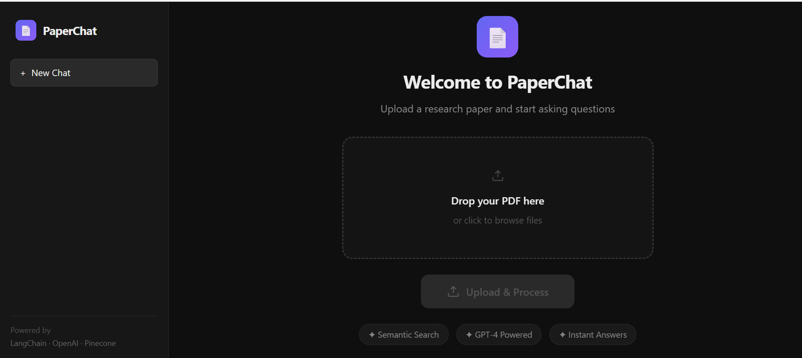
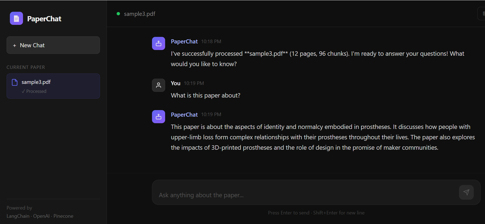

# 📄 PaperChat

> Chat with your research papers using AI. Upload any PDF and ask questions in natural language — powered by RAG, LangChain, OpenAI GPT-5.6, and Pinecone.

[](https://paperchat-bixg7nbyg-merub-shaikhs-projects.vercel.app/)
[](https://typescriptlang.org)
[](https://nextjs.org)
[](https://openai.com)
[](https://pinecone.io)

---

## 📌 Overview

PaperChat is a full-stack RAG (Retrieval-Augmented Generation) application that allows users to upload research papers and ask questions about them in natural language. Instead of reading through pages of dense academic text, users can get instant, accurate answers grounded in the paper's content.

Built as part of a research project at **Illinois Institute of Technology**, where qualitative research on assistive technology and mobility aids informed the design of accessible, user-centered interfaces.

---

## Features

- **📤 Drag & Drop Upload** — Upload any PDF research paper instantly
- **🧠 Semantic Search** — Finds relevant sections by meaning, not just keywords
- **💬 Conversational Q&A** — Ask questions in natural language
- **⚡ Fast Retrieval** — Sub-second responses using Pinecone vector database
- **🎯 Context-Aware** — GPT-5.6 answers grounded in your specific document
- **🔗 Clickable Citations** — Every answer cites its sources as `[1]` markers and page chips; click one to open the PDF at that page with the exact passage highlighted
- **🌙 Dark Mode UI** — Modern ChatGPT-like interface
- **📱 Responsive Design** — Works on desktop and mobile
- **🔒 Secure** — Files processed in memory, not stored permanently

---

## Screenshots

### Upload Screen


### Chat Interface


### Clickable Citations


---

## How It Works

PaperChat uses a **RAG (Retrieval-Augmented Generation)** pipeline:

```
📄 PDF Upload
     ↓
📝 Text Extraction       (LangChain PDFLoader)
     ↓
✂️  Chunking             (RecursiveCharacterTextSplitter)
     ↓                    chunk_size=1000, overlap=200
🔢 Embedding Generation  (OpenAI text-embedding-ada-002)
     ↓                    1536-dimensional vectors
🗄️  Vector Storage       (Pinecone - namespace per document)
     ↓
❓ User asks question
     ↓
🔍 Semantic Search       (Pinecone similarity search - top 6 chunks)
     ↓
🤖 Answer Generation     (GPT-5.6 + numbered context, cites passages as [n])
     ↓
🔗 Citations             ([n] markers mapped back to page + quoted passage)
     ↓
💡 Answer + citations returned; click a citation to highlight it in the PDF
```

---
## 📊 Evaluation Results

PaperChat was evaluated using **[RAGAS](https://docs.ragas.io/)** — the industry-standard RAG evaluation framework — measuring four metrics across 20 domain-specific questions on two accessibility research papers.

### 📐 Metrics Explained

| Metric | What It Measures | Target |
|--------|-----------------|--------|
| **Faithfulness** | Are answers grounded in retrieved chunks? Low score = hallucination | > 0.85 |
| **Answer Relevancy** | Do answers directly address the question asked? | > 0.85 |
| **Context Precision** | Are retrieved chunks actually relevant to the question? | > 0.85 |
| **Context Recall** | Did retrieval find all necessary information from the paper? | > 0.85 |


### 🔄 Iteration History — 5 Rounds of Improvement

The system was improved through **5 data-driven iterations**, each targeting a specific weakness identified by RAGAS scores:

| # | Change | Faithful | Relevancy | Precision | Recall | Key Finding |
|---|--------|----------|-----------|-----------|--------|-------------|
| 1 | Baseline | 0.650 | 0.463 | 0.964 | 0.850 | Retrieval strong, generation weak |
| 2 | Tightened system prompt | 0.859 | 0.709 | 0.968 | 0.850 | Faithfulness +32%, Relevancy +53% |
| 3 | Added answer format rules | 0.775 | 0.757 | 0.979 | 0.787 | Relevancy improved further |
| 4 | chunkSize 1000 → 500 | 0.909 | 0.750 | 0.961 | 0.733 | Faithfulness best, recall dropped |
| 5 | Retrieval k: 4 → 6 | **0.873** | **0.900** | **0.972** | **0.917** | All metrics above 0.85 ✅ |

> **Key Insight:** Chunk size and retrieval `k` are coupled parameters. Reducing chunk size improves faithfulness by providing cleaner context, but hurts recall because each chunk covers less content. Increasing `k` compensates by retrieving more chunks, recovering recall while maintaining precision gains. Final configuration: `chunkSize=500, k=6`.

### 🏆 Final Scores

Evaluated on 2 accessibility research papers:
- *"One Does Not Simply 'Mm-hmm': Exploring Backchanneling in the AAC Micro-Culture"* — ACM ASSETS '25
- *"Wheelchair Proxemics: Interpersonal Behaviour Between Pedestrians and Power Wheelchair Drivers"* — ACM VRST '24

| Metric | AAC Paper | Proxemics Paper | Average |
|--------|-----------|-----------------|---------|
| **Faithfulness** | 0.913 | 0.833 | **0.873** |
| **Answer Relevancy** | 0.853 | 0.947 | **0.900** |
| **Context Precision** | 0.955 | 0.988 | **0.972** |
| **Context Recall** | 0.867 | 0.967 | **0.917** |

✅ RAGAS Diagnosis: *"All metrics look good! Your RAG system is performing well."*

### 🧪 Run Evals Yourself

```bash
# Install Python dependencies
pip install ragas langchain-openai langchain-pinecone pinecone python-dotenv datasets

# Run evaluation pipeline
python evals/run_evals.py
```

Results are saved to `evals/results.json`.

The eval dataset (`evals/dataset.json`) contains 20 ground-truth question-answer pairs across both papers, covering factual questions, methodology questions, and finding-based questions.

---

## 🛠️ Tech Stack

| Category | Technology |
|----------|-----------|
| **Framework** | Next.js 15 (App Router) |
| **Language** | TypeScript |
| **AI Framework** | LangChain.js 0.3.x |
| **LLM** | OpenAI GPT-5.6 Sol (configurable via `OPENAI_CHAT_MODEL`) |
| **Embeddings** | OpenAI text-embedding-ada-002 (1536 dims) |
| **Vector Database** | Pinecone |
| **Styling** | Custom CSS (Dark Mode) |
| **Deployment** | Vercel (Serverless) |

---

## Getting Started

### Prerequisites

- Node.js 18+
- OpenAI API Key → [Get one here](https://platform.openai.com/api-keys)
- Pinecone API Key → [Get one here](https://app.pinecone.io)

---

### 1. Clone the Repository

```bash
git clone https://github.com/MerubS/PaperChat.git
cd PaperChat
```

### 2. Install Dependencies

```bash
npm install --legacy-peer-deps
```

### 3. Set Up Environment Variables

Create a `.env` file in the root directory:

```env
OPENAI_API_KEY=sk-your-openai-api-key-here
PINECONE_API_KEY=your-pinecone-api-key-here
PINECONE_INDEX_NAME=paperchat
```

### 4. Set Up Pinecone Index

1. Go to [app.pinecone.io](https://app.pinecone.io)
2. Click **Create Index**
3. Use these settings:

```
Name:        paperchat
Dimensions:  1536
Metric:      cosine
Vector Type: Dense
```

### 5. Run the Development Server

```bash
npm run dev
```

Open [http://localhost:3000](http://localhost:3000)

---

## 📁 Project Structure

```
PaperChat/
├── public/
│   └── screenshots/          # README screenshots
├── src/
│   ├── app/
│   │   ├── api/
│   │   │   ├── upload/
│   │   │   │   └── route.ts  # PDF upload & processing endpoint
│   │   │   └── query/
│   │   │       └── route.ts  # Question answering endpoint
│   │   ├── globals.css       # Global dark mode styles
│   │   ├── layout.tsx        # Root layout
│   │   └── page.tsx          # Main chat UI
│   ├── lib/
│   │   └── rag.ts            # Core RAG logic (LangChain + Pinecone)
│   └── test.ts               # Backend test script
├── .env                      # Environment variables (not committed)
├── .gitignore
├── next.config.js
├── package.json
└── tsconfig.json
```

---

## 🔌 API Endpoints

### `POST /api/upload`

Uploads and processes a PDF file into vector embeddings.

**Request:**
```
Content-Type: multipart/form-data
Body: { file: File (PDF, max 10MB) }
```

**Response:**
```json
{
  "success": true,
  "documentId": "550e8400-e29b-41d4-a716-446655440000",
  "chunks": 25,
  "pages": 10
}
```

---

### `POST /api/query`

Queries the document and returns an AI-generated answer.

**Request:**
```json
{
  "question": "What is this paper about?",
  "documentId": "550e8400-e29b-41d4-a716-446655440000"
}
```

**Response:**
```json
{
  "success": true,
  "response": "The study recruited AAC users and their partners [1]. Participants used gaze and facial expression [2].",
  "query": "What is this paper about?",
  "citations": [
    { "id": 1, "page": 4, "quote": "The study (1) foregrounds AAC users' lived expertise..." },
    { "id": 2, "page": 6, "quote": "Participants described..." }
  ]
}
```

---

## 🔒 Security & Limits

The API is public by default, so it's protected with:

- **Optional access code**: set `ACCESS_CODE` and every API call must send it. The app asks for it once per browser tab. Comparison is constant-time.
- **Per-IP rate limits**: uploads and questions are rate-limited and return `429` with `Retry-After`. Limits are in memory per server instance; on multi-instance serverless, swap in a shared store (e.g. Redis/DynamoDB).
- **Server-side file checks**: real PDF bytes (`%PDF-` header, not just the filename or MIME type), size limit, page limit (checked before paying for embeddings), and oversized bodies rejected from `Content-Length` before they're read.
- **No temp files**: uploads are parsed straight from memory.
- **Pinecone cleanup**: a paper's vectors are deleted on **New Chat** and when the tab closes (`sendBeacon`). Papers whose cleanup never ran are swept after `DOCUMENT_TTL_HOURS`. The API only accepts and deletes its own `u-<timestamp>-<uuid>` namespaces, so eval data (`aac`, `proxemics`) can't be queried or deleted through it.
- **Input validation and generic errors**: question length limit, document ID format check, and internal errors logged on the server rather than sent to the browser.

| Env var | Default | |
|---|---|---|
| `ACCESS_CODE` | *(unset = open)* | Shared code required for all API calls |
| `MAX_UPLOAD_MB` | `10` | Max PDF size (also update `MAX_UPLOAD_MB` in `page.tsx`) |
| `MAX_PDF_PAGES` | `60` | Max pages per PDF |
| `MAX_QUESTION_CHARS` | `1000` | Max question length |
| `UPLOADS_PER_HOUR` | `5` | Uploads per IP per hour |
| `QUESTIONS_PER_10_MIN` | `30` | Questions per IP per 10 minutes |
| `DOCUMENT_TTL_HOURS` | `24` | Age after which abandoned papers are swept |

Also set a monthly spending limit in your OpenAI account.

---

### Tests

```bash
npm run test:unit        # all unit tests
npm run test:citations   # citation parsing + PDF highlighting
npm run test:security    # access code, rate limits, file checks, cleanup rules
```

Checks citation parsing, and that every chunk the upload route creates is found and highlighted on its page in the viewer, using both eval papers.

---

## Configuration

Customize the RAG pipeline in `src/lib/rag.ts`:

```typescript
// Chunking settings
const splitter = new RecursiveCharacterTextSplitter({
  chunkSize: 1000,    // Increase for more context per chunk
  chunkOverlap: 200,  // Overlap to prevent cutting ideas mid-sentence
});

// Retrieval settings (src/lib/rag.ts)
const docs = await vectorStore.similaritySearch(query, 6); // number of chunks to retrieve
```

```env
# Model settings (.env), all optional
OPENAI_CHAT_MODEL=gpt-5.6-sol        # default; gpt-5.6-terra is cheaper and faster
OPENAI_REASONING_EFFORT=none         # none | low | medium | high
EVAL_JUDGE_MODEL=gpt-5.6-terra       # RAGAS judge model in evals/run_evals.py
```

> `gpt-4` and `gpt-3.5-turbo` were shut down by OpenAI on Oct 23, 2026. The iteration history above was measured with GPT-4 as the answer model; re-run `python evals/run_evals.py` for current scores.

---

## Deployment

### Deploy to Vercel

1. Push your code to GitHub
2. Import repo at [vercel.com](https://vercel.com)
3. Add environment variables:

```
OPENAI_API_KEY=sk-...
PINECONE_API_KEY=...
PINECONE_INDEX_NAME=paperchat
```

4. Click **Deploy** — done in under 2 minutes!

[](https://vercel.com/new/clone?repository-url=https://github.com/MerubS/PaperChat)

---

## Why RAG?

Traditional LLMs can only answer based on their training data. RAG solves this by:

| Without RAG | With RAG (PaperChat) |
|-------------|---------------------|
| ❌ Can't read your specific paper | ✅ Reads and understands your paper |
| ❌ May hallucinate facts | ✅ Answers grounded in document |
| ❌ No source citations | ✅ Shows which section the answer came from |
| ❌ Limited to training data | ✅ Works with any document |

---

## 🛣️ Roadmap

- [ ] Multi-document support (query across multiple papers)
- [ ] Chat history persistence
- [ ] Source highlighting (show exact paragraph in PDF)
- [ ] Export conversation as PDF
- [ ] Support for other file formats (DOCX, TXT)
- [ ] Streaming responses

---

## 🤝 Contributing

Contributions are welcome!

1. Fork the repository
2. Create your feature branch (`git checkout -b feature/NewFeature`)
3. Commit your changes (`git commit -m 'Add NewFeature'`)
4. Push to the branch (`git push origin feature/NewFeature`)
5. Open a Pull Request

---

## 👤 Author

**Merub Shaikh**

[](https://www.linkedin.com/in/merub-shaikh/)
[](https://github.com/MerubS)
[](mailto:merubnshaikh@gmail.com)

---

## 🙏 Acknowledgments

- [LangChain](https://langchain.com) — AI orchestration framework
- [OpenAI](https://openai.com) — GPT-5.6 and embeddings API
- [Pinecone](https://pinecone.io) — Vector database
- [Next.js](https://nextjs.org) — React framework
- [Vercel](https://vercel.com) — Deployment platform

---

<div align="center">
  <p>If you found this project helpful, please consider giving it a ⭐</p>
  <p>Built with ❤️ by <a href="https://github.com/MerubS">Merub Shaikh</a></p>
</div>
